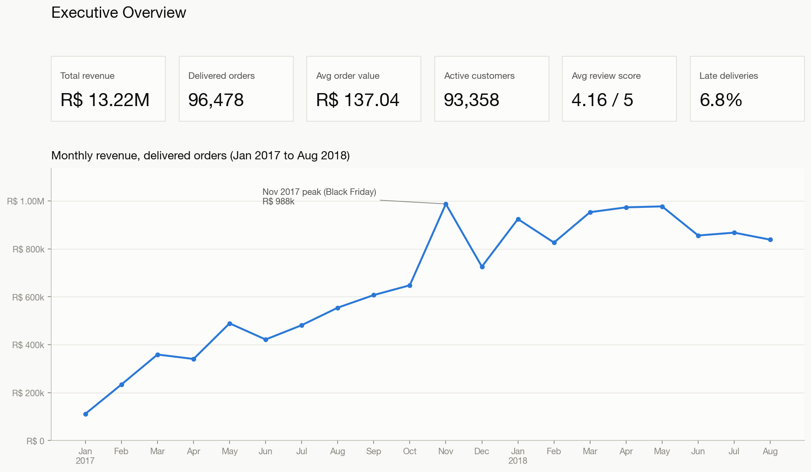
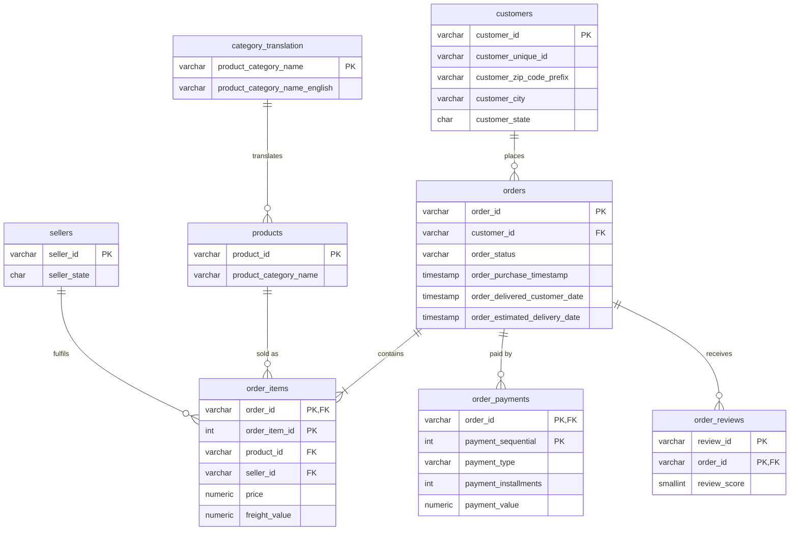
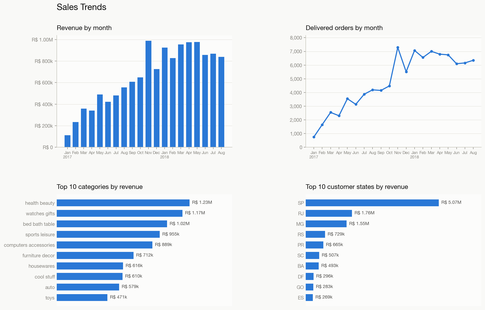
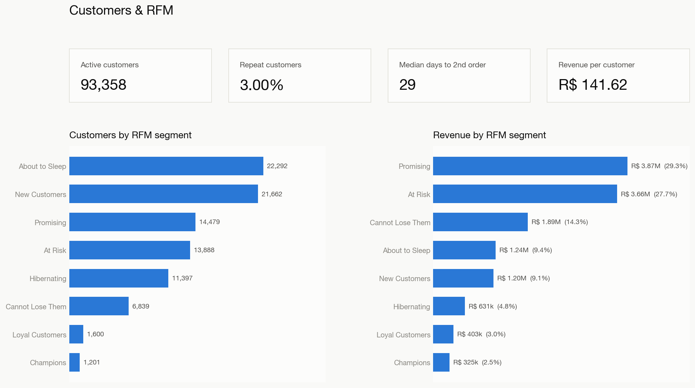
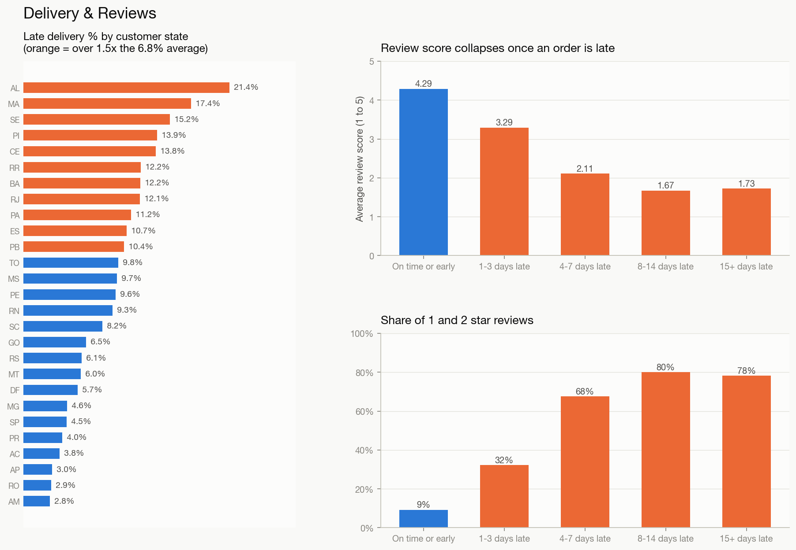
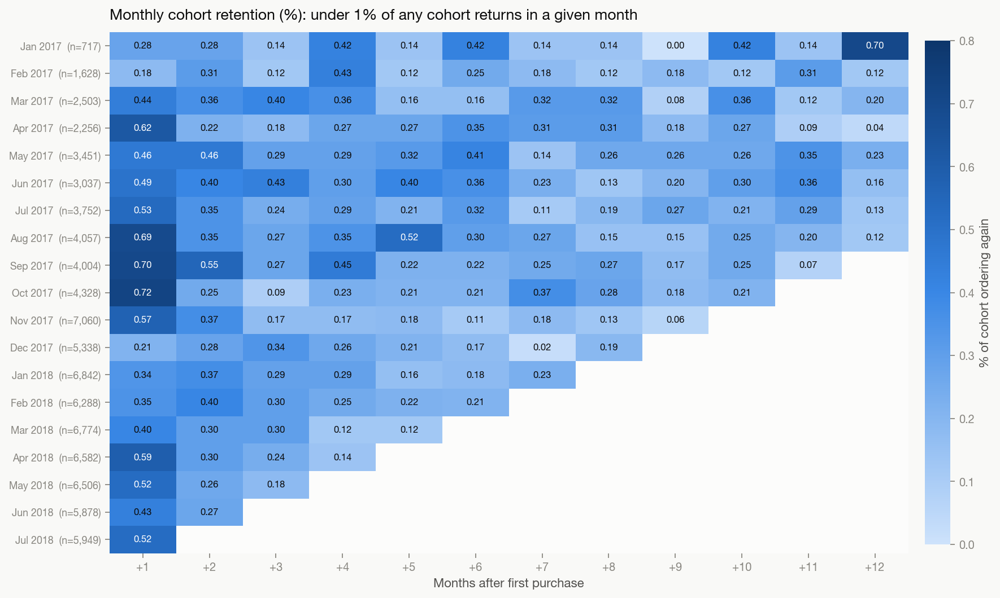
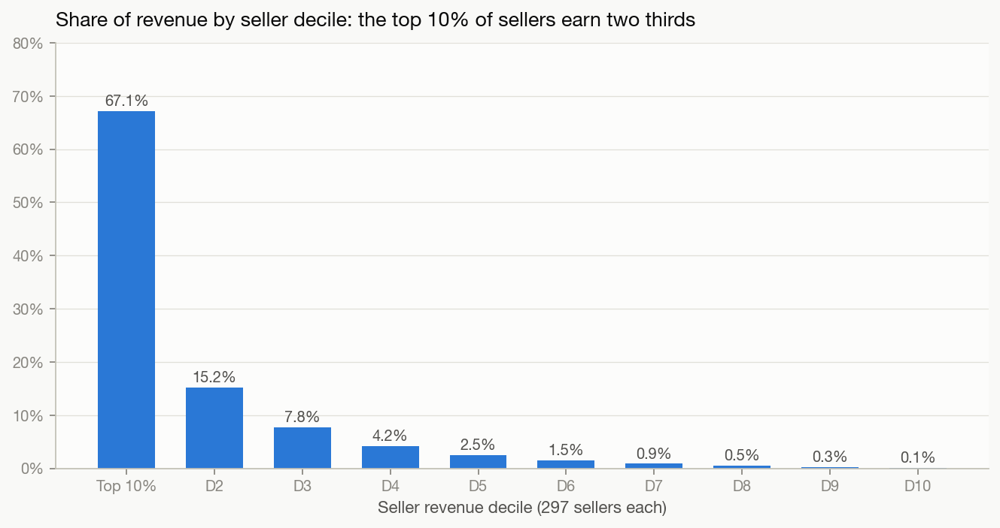
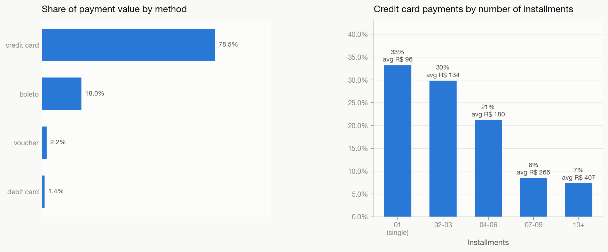

# Olist E-commerce Customer & Sales Analytics

SQL analysis and a Power BI dashboard on about 100k orders from Olist, a Brazilian online marketplace (2016 to 2018).
The pipeline goes from raw CSVs through data quality checks, eight business questions in SQL, a star
schema, a Power BI project, and static charts. `python run_all.py` rebuilds all of it.



## Business problem

Olist connects small Brazilian merchants to the big marketplaces. Growth was strong in 2017, but
leadership needs answers to four questions:

1. **Where does revenue come from**, and is growth coming from more orders or bigger baskets?
2. **Do customers come back?** What does retention look like, and which customers are worth winning back?
3. **How much does late delivery hurt** customer satisfaction, and where is it worst?
4. **Which sellers and payment habits** drive the business?

## Dataset

[Brazilian E-Commerce Public Dataset by Olist](https://www.kaggle.com/datasets/olistbr/brazilian-ecommerce)
(Kaggle, CC BY-NC-SA 4.0). It has 9 CSVs:

| Table | Rows | Grain |
|---|---:|---|
| orders | 99,441 | one order |
| order_items | 112,650 | one item line in an order |
| order_payments | 103,886 | one payment (orders can be split across methods) |
| order_reviews | 99,224 | one review |
| customers | 99,441 | one `customer_id` (a new id per order; the person is `customer_unique_id`) |
| products | 32,951 | one product |
| sellers | 3,095 | one seller |
| geolocation | 1,000,163 | zip prefix to lat/lng (not used) |
| category_translation | 71 | Portuguese to English category names |

Orders run from Sept 2016 to Oct 2018. Trends use the 20 complete months, **Jan 2017 to Aug 2018**.

## Tech stack

| Layer | Tool |
|---|---|
| Database | DuckDB 1.5 (SQL kept PostgreSQL-compatible) |
| Pipeline | Python 3.10, pandas |
| Analysis | SQL: CTEs, window functions (`LAG`, `NTILE`, `DENSE_RANK`, `ROW_NUMBER`, `LEAD`), `FILTER`, `PERCENTILE_CONT` |
| BI | Power BI Project (PBIP): TMDL semantic model, PBIR report, custom theme |
| Charts | matplotlib |

## ER diagram



For Power BI, the data is reshaped into a star schema: `fact_orders` and `fact_order_items`, with
`dim_customer` (including the RFM segment), `dim_product`, `dim_seller` and `dim_date`.

## Approach

1. **Load** (`scripts/load_data.py`). Creates the tables from `sql/01_schema.sql` with primary keys, foreign keys and checks, then loads every CSV. The row counts are checked against each source file.
2. **Data quality** (`sql/02_data_quality.sql`). Checks nulls, duplicates, orphan rows, impossible timestamps and the status mix. 18 findings, each with a handling rule, are in [`docs/data_quality.md`](docs/data_quality.md). The key rules:
   * only **delivered** orders count (96,478 of 99,441)
   * **revenue = item price**, freight excluded
   * customer = **`customer_unique_id`**
3. **Analysis** (`sql/03_analysis/`). One commented file per question, with results in `outputs/*.csv`.
4. **Star schema** (`sql/04_views/`). Six views, exported to `powerbi/data/*.csv`.
5. **Power BI** (`powerbi/OlistSalesAnalytics/`). TMDL model with 22 DAX measures and 4 report pages. Every report JSON file is validated against Microsoft's PBIR schemas.
6. **Charts** (`images/`). matplotlib renders of each dashboard page and the key analyses.

| # | Question | SQL | Output |
|---|---|---|---|
| 1 | Monthly revenue, orders, AOV, MoM / YoY growth | [01_monthly_revenue.sql](sql/03_analysis/01_monthly_revenue.sql) | `q1_*.csv` |
| 2 | Top 10 categories and revenue share | [02_top_categories.sql](sql/03_analysis/02_top_categories.sql) | `q2_top_categories.csv` |
| 3 | Monthly cohort retention matrix | [03_cohort_retention.sql](sql/03_analysis/03_cohort_retention.sql) | `q3_*.csv` |
| 4 | RFM segmentation | [04_rfm_segmentation.sql](sql/03_analysis/04_rfm_segmentation.sql) | `q4_*.csv` |
| 5 | Late delivery by state, impact on reviews | [05_delivery_reviews.sql](sql/03_analysis/05_delivery_reviews.sql) | `q5_*.csv` |
| 6 | Seller ranking (revenue and rating) | [06_seller_ranking.sql](sql/03_analysis/06_seller_ranking.sql) | `q6_*.csv` |
| 7 | Payment mix and installments | [07_payment_mix.sql](sql/03_analysis/07_payment_mix.sql) | `q7_*.csv` |
| 8 | Repeat rate, days to second order | [08_repeat_purchase.sql](sql/03_analysis/08_repeat_purchase.sql) | `q8_*.csv` |

## Key insights

All figures are from `outputs/*.csv`. Revenue = item price on delivered orders, in BRL (R$).
`scripts/verify_readme.py` checks every number in this section against those files.

1. **Growth came from more orders, not bigger baskets.** Jan to Aug 2018 revenue was R$ 7,218,125 against
   R$ 2,993,456 in the same months of 2017, up **141.13%**. Orders grew **139.94%**, while AOV barely
   moved (R$ 136.08 to R$ 136.75). After that, growth stalled: every month of 2018 landed between
   R$ 826,437 and R$ 977,545.
2. **Black Friday is the biggest single event.** November 2017 revenue hit R$ 987,765 (**+52.37% MoM**).
   24 Nov 2017 alone had 1,147 delivered orders, **4.7x** that month's daily average.
3. **Almost nobody comes back.** Only **3.0%** of 93,358 customers placed a second delivered order
   (2,801 people), and in any month after their first purchase, under 1% of a cohort orders again
   (0.483% at month 1). When customers do return, it happens fast: the median gap to the second order
   is **29 days**, or 75 days if 829 same-day "split basket" orders are excluded.
4. **Late delivery wrecks reviews.** 6.77% of delivered orders arrived after the estimated date. On-time
   orders average **4.29** stars and late ones **2.27**. The share of 1 and 2 star reviews rises from
   9.23% (on time) to **80.08%** (8 to 14 days late). Lateness is regional: **21.41%** of orders to
   Alagoas (AL) and 17.43% to Maranhão (MA) were late, against 4.49% in São Paulo (SP).
5. **Revenue is spread across categories but concentrated in sellers.** The top 10 categories make up
   62.43% of revenue, and the largest (health_beauty) only 9.33%. But the **top 10% of sellers (297)
   earn 67.11%** of revenue, and the top 30% earn 90.05%.
6. **Credit card plus installments is how Brazil pays.** Credit cards carry 78.46% of payment value,
   with 3.5 installments on average. Single-payment card transactions average R$ 95.60, while 10+
   installment payments average **R$ 407.47**, so installments are what make bigger baskets possible.
7. **The value at risk is large.** The RFM "At Risk" segment (13,888 one-time buyers who spent well but
   last ordered 6 to 12 months ago) holds **27.69%** of all revenue (R$ 3,660,858), almost as much as
   recent high spenders ("Promising", 29.25%).

## Business recommendations

1. **Make retention the growth lever.** Volume growth has stalled and 97% of buyers never return, so
   each new customer brings in a single basket. Start a second-purchase journey (voucher, category cross-sell) in the **first 30 days**, the median
   window in which returning customers come back.
2. **Win back "At Risk" customers first.** They are 15% of customers and 28% of revenue. Send targeted
   reactivation offers for their past categories, and measure the result against a holdout group.
3. **Fix delivery estimates in the North and Northeast.** Either pad the estimated date for AL, MA, SE,
   PI and CE, or route through better carriers there. A late order costs about 2 review stars, and
   reviews drive marketplace ranking.
4. **Look after the top seller decile.** Two thirds of revenue sits with 297 sellers. Give them account
   management and SLA monitoring, and watch the ones with low ratings: several top-25 sellers rank
   below 80th by rating.
5. **Plan capacity around Black Friday.** Daily orders peak at almost 5x normal. Line up logistics
   and seller stock in advance so the spike does not turn into late deliveries and bad reviews.
6. **Promote installments on high-ticket categories.** Payments split into 10 or more installments are
   about 4x the size of single payments. Interest-free installment offers in high-AOV categories
   (watches_gifts, cool_stuff) can lift basket size, which has been flat.

## Dashboard screenshots

The Power BI report has four pages: Executive Overview, Sales Trends, Customers & RFM, and
Delivery & Reviews. The images below are matplotlib renders of the same metrics and layout, built
from the SQL outputs.

| Sales Trends | Customers & RFM |
|---|---|
|  |  |

| Delivery & Reviews | Cohort retention |
|---|---|
|  |  |

| Seller concentration | Payment mix |
|---|---|
|  |  |

## Repo structure

```
olist-sales-analytics/
├── run_all.py                  # one command: rebuild everything from raw data
├── requirements.txt
├── DECISIONS.md                # every judgement call, with the reason
├── sql/
│   ├── 01_schema.sql           # tables, PKs, FKs, checks
│   ├── 02_data_quality.sql     # nulls, duplicates, orphans, dates, status mix
│   ├── 03_analysis/            # 8 business questions, one file each
│   └── 04_views/               # star schema views for Power BI
├── scripts/
│   ├── common.py               # paths + SQL runner ("-- @output:" blocks -> CSV)
│   ├── download_data.py        # kagglehub -> Kaggle CLI -> mirror, verified by row counts
│   ├── load_data.py            # build DuckDB and load CSVs
│   ├── run_quality.py / run_analysis.py / build_views.py
│   ├── build_pbip.py           # generate the Power BI project + build guide
│   ├── validate_pbip.py        # JSON schema + TMDL lint + field reference checks
│   ├── make_charts.py          # PNG charts
│   └── verify_readme.py        # checks README figures against outputs/
├── outputs/                    # query results (CSV); data_quality/ subfolder
├── powerbi/
│   ├── data/                   # star schema CSVs read by Power BI
│   ├── theme/OlistTheme.json
│   └── OlistSalesAnalytics/    # .pbip + .SemanticModel (TMDL) + .Report (PBIR)
├── images/                     # charts used in this README
├── docs/
│   ├── data_quality.md
│   ├── powerbi_build_guide.md
│   ├── sql_concepts.md
│   └── interview_prep.md
└── data/raw/                   # downloaded CSVs (git-ignored)
```

## How to reproduce

```bash
git clone https://github.com/jasleenkdev/olist-sales-analytics.git
cd olist-sales-analytics
pip install -r requirements.txt
python run_all.py
```

`run_all.py` downloads the data (with `kagglehub` and no credentials, falling back to the Kaggle CLI)
and then runs everything else in order: load and verify, quality checks, analysis, views and exports,
Power BI project generation and validation, charts, and README verification. It takes about a minute.

To open the dashboard, open `powerbi/OlistSalesAnalytics/OlistSalesAnalytics.pbip` in Power BI Desktop,
set the `DataFolder` parameter to your local `powerbi/data/` folder, and refresh. Details are in
[`docs/powerbi_build_guide.md`](docs/powerbi_build_guide.md).
